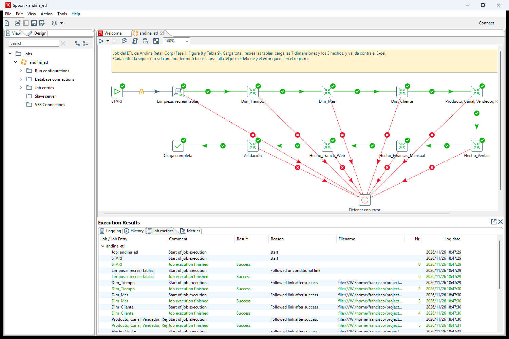
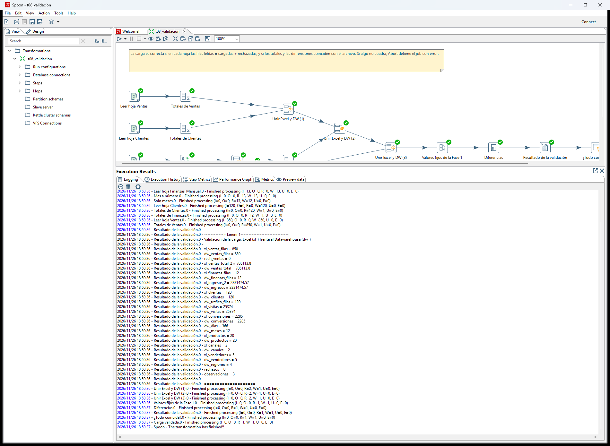
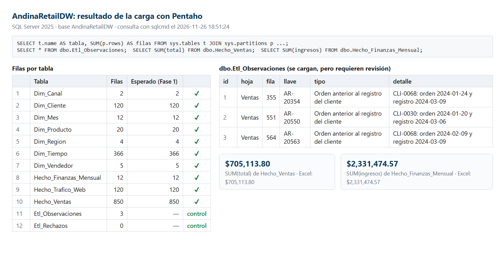

# Parte 1: ETL en Pentaho Data Integration

**Qué es esta carpeta:** el ETL que propusimos en la Fase 1 (sección 5.2, Tablas 9 y 10), hecho en **Pentaho Data Integration 9.4**. Lee el Excel del caso, lo limpia y carga el Datawarehouse `AndinaRetailDW` en SQL Server. Al final valida la carga contra el Excel y detiene el job si algo no cuadra.

**Para quién:** la parte 1 (ETL). Las demás partes no necesitan Pentaho: trabajan con la base ya cargada o con los CSV de `data/sample/`.

**Estado (26 nov 2026):** terminado y verificado, también desde un clon limpio en `C:\`. Ver [Cómo se verificó](#cómo-se-verificó).

> **¿Eres de las partes 2, 3 o 4?** No necesitas instalar Pentaho. Para tener la base `AndinaRetailDW` en tu SQL Server corre `.venv\Scripts\python -m etl.run_etl` (README principal): carga **exactamente las mismas tablas y llaves** que este ETL. Si no tienes SQL Server, usa los CSV de `data/sample/`. Solo quien grabe la parte del ETL en el video necesita Pentaho.



## Qué produce

Las mismas 12 tablas de [`sql/ddl/01_tablas.sql`](../sql/ddl/01_tablas.sql), con **las mismas llaves** que el ETL de Python (`tiempo_key` = AAAAMMDD, `mes_key` = AAAAMM, las demás 1..n en orden alfabético; decisión D1). Por eso los CSV, K-means y Power BI siguen funcionando sin cambios.

| Tabla | Filas | Origen |
|---|---|---|
| Dim_Tiempo / Dim_Mes | 366 / 12 | Se generan (2024) |
| Dim_Cliente | 120 | Hoja Clientes + resultado de K-means |
| Dim_Producto / Dim_Canal / Dim_Vendedor | 20 / 2 / 5 | Hoja Ventas |
| Dim_Region | 4 | Ventas.Region + Clientes.Region |
| Hecho_Ventas | 850 ($705,113.80) | Hoja Ventas |
| Hecho_Finanzas_Mensual | 12 ($2,331,474.57 de ingresos) | Hoja Finanzas_Mensual |
| Hecho_Trafico_Web | 120 (25,374 visitas, 2,285 conversiones) | Hoja Clientes |
| Etl_Rechazos / Etl_Observaciones | 0 / 3 | Control de calidad |

## Archivos

| Archivo | Qué hace | Pasos de Pentaho (Fase 1, Tabla 10) |
|---|---|---|
| `andina_etl.kjb` | **Job principal.** Ejecuta todo en orden; si una entrada falla, se detiene | START → SQL → 8 transformaciones → Success / Abort |
| `sql/00_recrear_tablas.sql` | Limpieza: borra y recrea las tablas (carga total) | Paso SQL del job |
| `t01_dim_tiempo.ktr` | 366 días de 2024 | Generate rows, Add sequence, Calculator, Value mapper |
| `t02_dim_mes.ktr` | 12 meses (dimensión conformada) | Generate rows, Add sequence, Value mapper, Add constants |
| `t03_dim_cliente.ktr` | Clientes + `segmento_cluster` de K-means | Microsoft Excel input, Select values, Unique rows (HashSet), Sort rows, Add sequence, CSV input, Stream lookup |
| `t04_dims_ventas.ktr` | Producto, canal, vendedor y región | Unique rows (HashSet), Append streams, Sort rows, Add sequence |
| `t05_hecho_ventas.ktr` | 850 órdenes | Stream lookup, Calculator, copia en dos ramas, 8 Database lookup, Filter rows |
| `t06_hecho_finanzas.ktr` | 12 meses de finanzas | Value mapper, Filter rows, Calculator, Database lookup |
| `t07_hecho_trafico_web.ktr` | Visitas y conversiones por cliente | Add constants, Select values, Database lookup |
| `t08_validacion.ktr` | Compara Excel ↔ Datawarehouse; aborta si no coincide | Group by, Table input, Join rows, Calculator, Filter rows, Write to log, Abort |
| `ejecutar_etl.bat` | Corre el job completo con Kitchen y guarda el registro en `logs/etl.log` | — |

Cada transformación tiene una nota amarilla en el lienzo que explica qué hace y qué regla de la Fase 1 aplica.

### Rechazos y observaciones

- **Rechazos** (`Etl_Rechazos`, la fila no se carga): fecha que no se puede convertir, `OrdenID` o `ClienteID` repetido, cliente que no existe en Clientes, llave no encontrada en una dimensión, o fila que la base de datos no aceptó. Salen por el **manejo de errores** de cada paso (flechas rojas en el lienzo), con la hoja, la fila del Excel, la llave y la causa.
- **Observaciones** (`Etl_Observaciones`, la fila se carga pero se anota): orden anterior al registro del cliente, y Total, UtilidadNeta o RetornoInversion que no coinciden con su recálculo.
- Los ids de ambas tablas son consecutivos entre transformaciones: cada una parte del mayor id que ya existe.

## Instalación (una vez por computadora, Windows)

1. **Java 8 u 11** (por ejemplo Eclipse Temurin 8). Comprobar con `java -version`.
2. **Pentaho Data Integration 9.4 CE** (`pdi-ce-9.4.0.0-343.zip`, 385 MB): descomprimir en `C:\pentaho` para que quede `C:\pentaho\data-integration\Spoon.bat`.
3. **Driver de SQL Server** (no viene con Pentaho): copiar `mssql-jdbc-12.8.1.jre8.jar` a `C:\pentaho\data-integration\lib\`.
4. **Autenticación de Windows:** copiar `mssql-jdbc_auth-12.8.1.x64.dll` a `C:\pentaho\data-integration\libswt\win64\`. Los dos archivos están en Maven Central (`com.microsoft.sqlserver:mssql-jdbc:12.8.1.jre8` y `mssql-jdbc_auth:12.8.1.x64`).
5. **SQL Server con TCP/IP activo en el puerto 1433** (SQL Server Configuration Manager → Protocolos → TCP/IP → Habilitado) y la base creada:
   ```sql
   CREATE DATABASE AndinaRetailDW;
   ```

Si tu servidor no es `localhost:1433`, cambia los parámetros `DW_HOST`, `DW_PORT` y `DW_DB` del job (en Spoon: clic derecho en el lienzo → *Parameters*), o pásalos a Kitchen: `ejecutar_etl.bat /param:DW_HOST=MIPC\SQLEXPRESS`. Si usas usuario y contraseña de SQL Server en vez de Windows, edita la conexión `AndinaRetailDW` y desmarca *Use Integrated Security*.

> **Ojo:** el repo debe estar en una ruta de Windows (por ejemplo `C:\Users\tu-usuario\dmd-proyecto-catedra-fase2`). Java no abre rutas `\\wsl.localhost\...`; si trabajas desde WSL, asigna una letra de unidad (`net use W: \\wsl.localhost\Ubuntu`) y abre el job desde `W:`.

## Ejecutar

**Con un comando** (desde la raíz del repo):

```powershell
pentaho\ejecutar_etl.bat
```

Tarda unos 6 segundos y debe terminar con `Kitchen termino con codigo 0`. El detalle queda en `pentaho/logs/etl.log`, con el bloque de validación (`xl_` = Excel, `dw_` = Datawarehouse).

**En Spoon** (para el video): `C:\pentaho\data-integration\Spoon.bat` → *File → Open* → `pentaho/andina_etl.kjb` → ▶ *Run* (F9) → *Run*. Abajo, en *Execution Results*, la pestaña *Job metrics* muestra cada entrada con *Success*. Una transformación se abre con clic derecho en su entrada → *Open referenced object*.

> Para ejecutar **una transformación sola** (por ejemplo `t05` para ver sus *Step Metrics*), primero vacía su tabla; si no, la llave primaria rechazará las filas repetidas. Las dimensiones (`t01` a `t04`) no se pueden correr solas sobre una base cargada: usa el job completo, que recrea todo. `t08_validacion` es de solo lectura y se puede correr cuando quieras.

**Segunda comprobación, independiente de Pentaho:** el validador de Python compara la base con el Excel, los CSV y los KPIs, y regenera `data/sample/reporte_carga.md`:

```powershell
.venv\Scripts\python -m etl.run_etl --validar-bd
```

## Cómo se verificó

1. **Validación del propio job** (`t08`): filas leídas = cargadas + rechazadas en cada hoja; totales, visitas, conversiones y tamaño de cada dimensión iguales al Excel. Si algo no coincide, *Abort* detiene el job con error.
2. **Validador de Python** (`etl.run_etl --validar-bd`): `OK`, incluidos los 10 KPIs (margen bruto 41.57 %, margen neto 26.90 %, ticket promedio $829.55, etc.).
3. **Comparación fila por fila** con el ETL de Python: las 12 tablas son idénticas (mismas llaves, valores y textos de observación).
4. **Prueba de errores** con una copia alterada del Excel (fecha con otro formato, cliente inexistente, `OrdenID` repetido y fecha de registro inválida): las 7 filas afectadas quedaron en `Etl_Rechazos` con su causa, y la validación detuvo el job, como debe.

## Evidencia (para el informe y el video)

Capturas del 26 de noviembre de 2026 en `docs/img/etl/`:

| Archivo | Qué muestra | Uso sugerido |
|---|---|---|
| `etl-00-perfilado.png` | Perfilado del Excel antes de limpiar (tipos, nulos, distintos, mín. y máx.) | Sección 2.1 |
| `etl-01-job-diseno.png` | El job en Spoon: limpieza, 7 dimensiones, 3 hechos, validación | Sección 2.2 |
| `etl-02-job-ejecutado.png` | El job ejecutado: todas las entradas con *Success* (*Job metrics*) | Sección 2.2 |
| `etl-03-t05-diseno.png` | `t05_hecho_ventas`: lookups, Calculator, rama de observaciones y rechazos | Sección 2.2 / 2.3 |
| `etl-04-t05-ejecutado.png` | `t05` ejecutada: *Step Metrics* con 850 filas leídas y escritas | Sección 2.4 |
| `etl-05-validacion-diseno.png` | `t08_validacion`: Excel y Datawarehouse unidos y comparados | Sección 2.4 |
| `etl-06-validacion-ejecutada.png` | Registro de la validación: `xl_` = `dw_` y "Carga validada" | Sección 2.4 |
| `etl-07-t04-dimensiones.png` | `t04`: Unique rows (HashSet) y Append streams para las dimensiones | Sección 2.2 |
| `etl-08-sql-conteos.png` | Filas por tabla, observaciones y totales consultados en SQL Server | Sección 2.4 |





## Si algo falla

| Síntoma | Causa probable | Solución |
|---|---|---|
| `Driver class 'com.microsoft.sqlserver.jdbc.SQLServerDriver' could not be found` | Falta el `.jar` del driver | Paso 3 de la instalación |
| `This driver is not configured for integrated authentication` | Falta la `.dll` de autenticación | Paso 4, y reiniciar Spoon |
| `Connection refused` / `TCP/IP connection ... failed` | TCP/IP apagado o puerto distinto | Paso 5, o parámetro `DW_PORT` |
| `FileNotFoundException ... \wsl.localhost\...` | El repo está en WSL | Abrir desde una letra de unidad (ver la nota de instalación) |
| Kitchen termina con código 9 | La carpeta actual termina en `\` (por ejemplo `C:\`) | Usar `ejecutar_etl.bat`, que ya lo evita |
| La validación aborta | Hay rechazos o el Excel cambió | Revisar `SELECT * FROM dbo.Etl_Rechazos` y el bloque `xl_`/`dw_` del registro |
| Al abrir Spoon sale "Unable to open file" | Spoon intenta reabrir un archivo que ya no existe | Cerrar el aviso; no afecta |
| La consola se llena de `INFO: ConnectionID:… TDS_COLMETADATA` | Mensajes informativos del driver de SQL Server | Son normales. Lo que importa es la última línea: `Kitchen termino con codigo 0` |
| La carga funcionaba y ahora falla la llave de `Hecho_Ventas` | Desde D10 la llave primaria es solo `orden_id` | Ejecutar el job completo, que recrea las tablas con el DDL nuevo |
